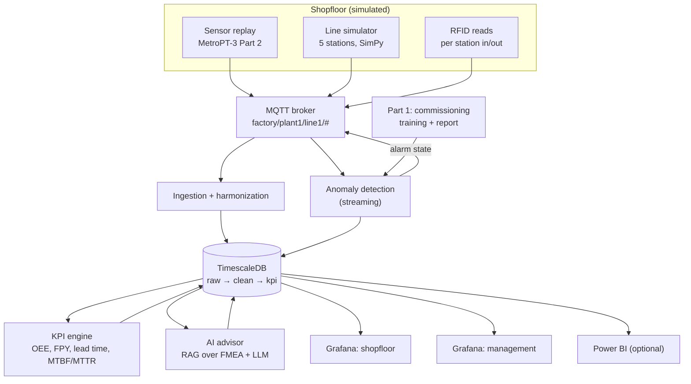

# Production Digitalization Platform

**End-to-end shopfloor data platform: live machine data → MQTT → harmonized time-series database → OEE / RFID KPIs → predictive maintenance → AI recommendations → shopfloor and management dashboards. Starts with one click.**

The idea mirrors how a real plant brings a machine online:

1. **Commissioning (Part 1).** A public industrial dataset is split *by time*. The first month acts as the machine's acceptance test: the platform learns what "healthy" looks like.
2. **Live operation (Part 2).** The rest of the dataset is streamed over MQTT as if it came from the machine's PLC, next to a simulated 5-station assembly line with RFID tracking.
3. **Monitoring and decisions.** Every reading is harmonized, stored, turned into KPIs, checked against the commissioning baseline and, when something drifts, explained with a recommended action.

---

## One-click start

| Windows | macOS / Linux |
|---|---|
| Install [Docker Desktop](https://www.docker.com/products/docker-desktop/), then double-click **`start.bat`** | Install Docker, then run **`./start.sh`** |

The first start takes 5–15 minutes: it builds the image, downloads the dataset (~208 MB) and the local AI model (~1 GB), and trains the model. Later starts take under a minute. When everything is ready, the shopfloor dashboard opens in your browser.

| What | Where |
|---|---|
| Shopfloor dashboard (live) | http://localhost:3000/d/shopfloor |
| Management dashboard | http://localhost:3000/d/management |
| Compressor health (predictive maintenance) | http://localhost:3000/d/asset-health |
| Commissioning report (model + evaluation) | `reports/commissioning_report.html` |
| Database for Power BI / Excel | `localhost:5432`, db `factory`, user `bi_reader` / `bi_reader` |
| MQTT broker (e.g. MQTT Explorer) | `localhost:1883`, topic `factory/#` |

`stop.bat` / `stop.sh` stops everything (data is kept), `logs.bat` / `logs.sh` shows live logs, and `reset.bat` / `reset.sh` starts from scratch.

**What you'll see:** the replay starts 12 hours (dataset time) before the first recorded air-leak failure. At the default speed (60×), the compressor health score drops within roughly 10–15 minutes and an alarm opens. The AI advisor posts a likely cause and recommended actions, the panel bonding station (which uses the compressed air) slows down and books `low_air_pressure` stops, and the OEE and downtime Pareto react. For a faster demo, set `REPLAY_SPEED=300` in `.env`.

---

## Architecture



| Layer | Component | Technology |
|---|---|---|
| Source | `simulators/sensor_replay` replays Part 2 of the dataset in real time | Python, paho-mqtt |
| Source | `simulators/line_simulator` runs a discrete-event model of a 5-station line with RFID | SimPy |
| Transport | ISA-95 style topics `factory/<plant>/<line>/<asset>/<type>` | Mosquitto (MQTT) |
| Ingestion | Validation, raw audit trail, harmonization of heterogeneous station formats, RFID de-duplication | Python |
| Storage | `raw` → `clean` → `kpi` schemas, hypertables, retention | TimescaleDB (PostgreSQL 16) |
| Analytics | OEE (A×P×Q), FPY, throughput, WIP, MTBF/MTTR, RFID lead time and flow efficiency, data quality | pandas |
| ML | Window features → Isolation Forest + SPC z-score ensemble, alarm persistence and hysteresis | scikit-learn |
| AI | Retrieval over the FMEA/SOP knowledge base + LLM with JSON validation and a rule-based fallback | Ollama (local) or Claude API |
| Presentation | Three provisioned dashboards (dashboards as code) and SQL views for BI tools | Grafana, Power BI |
| Ops | One image for all Python services, start-up ordering, one-click launchers | Docker Compose |

More detail is in [docs/architecture.md](docs/architecture.md).

---

## Project structure

```
production-digitalization-platform/
├── start.bat / start.sh            one-click start (stop, logs, reset next to it)
├── docker-compose.yml              all services and their start-up order
├── .env.example                    every setting in one place
├── common/                         shared config, DB/MQTT helpers, features, health model, alarm logic
├── pipeline/
│   ├── data_prep/                  download, clean, time-based split (+ synthetic fallback)
│   └── training/                   commissioning analysis, model training, evaluation, HTML report
├── simulators/
│   ├── sensor_replay/              "the live machine"
│   └── line_simulator/             assembly line + RFID (SimPy)
├── services/
│   ├── ingestion/                  MQTT → raw → harmonize → clean
│   ├── kpi_engine/                 OEE, FPY, lead time, MTBF/MTTR, data quality
│   ├── anomaly_detection/          streaming health score + alarms
│   └── ai_advisor/                 RAG + LLM recommendations and shift summaries
├── knowledge_base/                 FMEA and SOPs the advisor retrieves from (plain Markdown)
├── database/init/                  schema, views, read-only BI role
├── infra/                          Mosquitto config, Grafana provisioning and dashboards-as-code
├── dashboards/powerbi/             Power BI connection notes
├── docs/                           architecture, KPI definitions, data dictionary, data source
│                                   assessment, use cases, validation, Power BI guide
├── tests/                          unit tests (harmonization, KPIs, model, advisor)
├── data/  models/  reports/        created at runtime
```

---

## Configuration

Edit `.env`, which is created from `.env.example` on first start. The settings you're most likely to change:

| Setting | Default | Meaning |
|---|---|---|
| `REPLAY_SPEED` | `60` | 60 = one hour of machine data per real minute |
| `LIVE_START` | `auto` | `auto` starts 12 h before the first known failure. Also accepts a date, or `start` |
| `DATASET` | `metropt3` | `synthetic` works fully offline (same format) |
| `COMMISSIONING_END` | `2020-03-01` | End of Part 1 (the training period) |
| `COMPOSE_PROFILES` | `llm` | Leave empty to skip the local LLM; the advisor then uses rule-based answers |
| `LLM_PROVIDER` | `ollama` | `ollama`, `anthropic` (needs `ANTHROPIC_API_KEY`) or `rules` |
| `LINE_TIME_SCALE` | `1` | Speeds up the assembly line simulation |
| `KPI_BUCKET_MINUTES` | `15` | KPI aggregation interval |

If the dataset download fails (no internet, UCI unavailable), the platform automatically falls back to synthetic data in the same format, so it always starts.

---

## Results

`reports/commissioning_report.html` is generated on every training run. It contains the healthy operating ranges, the normal load/unload cycle, the health score over the whole live period with the published failure windows, and a close-up of the first failure. `reports/model_evaluation.json` lists, for each failure, whether it was detected and with how much early warning, plus false alarms per week. See [docs/validation.md](docs/validation.md) for how the results were checked.

---

## Development

```bash
pip install -r requirements-dev.txt
pytest                              # 20 unit tests
python infra/grafana/build_dashboards.py   # regenerate dashboards after editing panels
```

Every service can also run outside Docker against a local PostgreSQL and MQTT broker. All settings come from environment variables (`common/config.py`).

---

## Data source and licence

Machine data: **MetroPT-3 Dataset**, Davari, N., Veloso, B., Ribeiro, R., & Gama, J. (2021), UCI Machine Learning Repository, https://doi.org/10.24432/C5VW3R, licensed CC BY 4.0. Production line, RFID and knowledge base content are synthetic and created for this project.

Code: MIT licence (see `LICENSE`).
